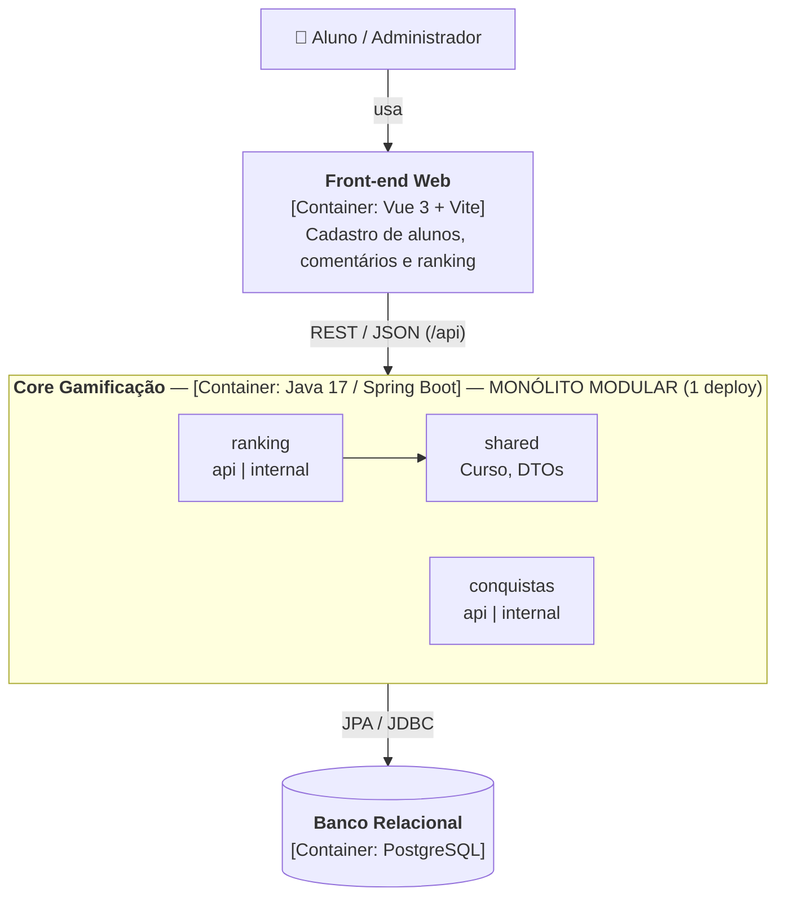

# Registro Arquitetural — Desafio 1: Drivers e Evolução do Core

> Exercício B1 (Architecture Lab): evolução do Core de Gamificação (legado da AC1).
> Padrão da decisão: **RF → RNF → ASR → RPC → Alternativas → ADR → C4 → Evidência**.

| Item | Registro |
|---|---|
| Projeto | `ac1_atdd` (legado da AC1) |
| Decisão | Monólito em Camadas → **Monólito Modular** |
| ADR | [ADR-001](#7-adr-001--evoluir-o-core-de-monólito-em-camadas-para-monólito-modular) — ✅ Aceito |
| Evidência | Mini-lab antes/depois + `ArquiteturaModularTest` + 12 testes passando |

---

## 1. Leitura do cenário

O MVP da AC1 (ranking mensal de participação no fórum, em que o mais ativo ganha um curso como recompensa) cresce de ~1.000 para até **100.000 usuários** e passa a receber novas capacidades de gamificação, como **Conquistas**. O **Ranking** cresce mais que as demais capacidades, enquanto Cursos e Conquistas evoluem em ritmo próprio.

**Pergunta do Tech Lead:** há evidência suficiente para introduzir distribuição e deploy independente agora, ou uma modularização interna resolve o problema com menor custo operacional?

## 2. RF — requisitos funcionais afetados

| ID | Requisito funcional | Onde está no código | Impacto no desafio |
|---|---|---|---|
| RF01 | **Ranking** mensal de participação no fórum (comentários úteis geram pontuação e o 1º colocado ganha um curso) | `ranking/` — `ForumRewardController`, `ForumRewardService` | Carga tende a crescer mais; precisa continuar evolutivo e mensurável. |
| RF02 | **Conquistas / gamificação** (badges e critérios) | `conquistas/` — `ConquistasController`, `ConquistasService` | Evolui em ritmo diferente do Ranking; precisa de fronteira própria. |
| RF03 | Evolução das funcionalidades existentes (cursos, alunos) | `shared/` (Curso) e `ranking/` (Aluno) | A mudança não pode quebrar o comportamento da AC1. |

## 3. RNF (FURPS+) e seleção dos ASRs

Nem todo RNF é ASR. Só foram escolhidos os que alteram **estrutura, implantação ou operação** do Core (máx. 3).

| RNF (FURPS+) | ASR? | Justificativa arquitetural |
|---|---|---|
| **Manutenibilidade** (Supportability) | ✅ **SIM — ASR-01** | Ranking e Conquistas mudam em ritmos diferentes. Sem fronteiras explícitas, uma mudança em um espalha alterações por todas as camadas. **Altera a estrutura** do código. |
| **Escalabilidade** (Performance) | ✅ **SIM — ASR-02** | O Ranking cresce mais que o resto e pode exigir estratégia própria no futuro. **Altera a estrutura** (precisa de uma fronteira extraível) e, futuramente, a **implantação**. |
| **Complexidade operacional** (+ restrição de equipe) | ✅ **SIM — ASR-03** | Uma equipe de 6 pessoas teria de absorver N deploys, rede, contratos, observabilidade e falhas distribuídas se serviços forem introduzidos agora. **Altera a operação.** |
| Desempenho (Performance) | ❌ NÃO, neste momento | Relevante, mas não há medição de latência/throughput que prove gargalo arquitetural. |
| Testabilidade (Supportability) | ❌ NÃO como driver macro | Melhora com a modularização, mas sozinha não determina a decomposição do sistema. |

## 4. RPC — restrições e premissas

| RPC | Consequência para a decisão |
|---|---|
| RPC-01 — Core em **Java 17 / Spring Boot** | A evolução preserva o investimento existente; nada de trocar linguagem/framework. |
| RPC-02 — Equipe de **6 desenvolvedores** | A complexidade operacional precisa ser proporcional à equipe. |
| RPC-03 — **Banco relacional** (PostgreSQL) | Não há justificativa para trocar a tecnologia de dados por "modernização". |
| RPC-04 — **Legado da AC1** | Evolução incremental, sem reescrita: mesmas classes, mesmos endpoints, mesmos testes. |

## 5. Alternativas e trade-offs

| Alternativa | Benefícios | Custos / riscos | ASR que justificaria | Avaliação |
|---|---|---|---|---|
| **A — Monólito em Camadas** (AC1) | Baixa complexidade operacional; zero esforço; continuidade imediata. | Organização por camada técnica: cada capacidade fica espalhada em `controller/`, `service/`, `repository/`, `domain/`; acoplamento cresce com o produto. | Só ASR-03. | Possível, mas pouco preparado para a evolução prevista. |
| **B — Monólito Modular** | Fronteiras por capacidade; **um único deploy**; manutenção localizada; Ranking vira candidato claro a extração futura. | Ainda compartilha processo (JVM), banco e deploy; **não dá escala independente** ao Ranking; fronteiras exigem disciplina (mitigado por teste automatizado). | ASR-01 e ASR-03; **prepara** ASR-02. | ✅ **Melhor equilíbrio entre ASRs e RPCs.** |
| **C — Serviço(s) independente(s)** (ex.: extrair Ranking) | Escala e deploy independentes por capacidade. | Rede, contratos, consistência de dados, observabilidade distribuída, N pipelines — alto custo para 6 devs. | ASR-02 **com evidência medida**. | Prematuro: o cenário informa crescimento, mas não prova gargalo nem necessidade de deploy independente. |

**Respostas às questões do Tech Lead:**
- *Se só o ranking exige mais capacidade, precisamos escalar todo o sistema?* Hoje sim (A e B escalam o processo inteiro). Esse é o trade-off aceito; a fronteira modular permite extrair só o Ranking quando houver evidência.
- *Menor complexidade operacional?* A e B (um deploy). *Maior independência de evolução?* C, seguida de B.
- *A equipe tem maturidade para operar distribuído?* Com 6 devs e sem observabilidade distribuída instalada, não ainda.

## 6. Decisão do Tech Lead

> **DECISÃO: evoluir o Core para um MONÓLITO MODULAR.**

O código passa a ser organizado por **capacidade de negócio** — `ranking`, `conquistas` e `shared` — mantendo **um único Core Spring Boot e um único deploy**. Cada módulo expõe um pacote público `api/` (controllers e DTOs) e esconde a implementação em `internal/` (domínio, serviço e repositório). O Ranking é tratado como **candidato explícito à extração futura**, mas **não** vira microsserviço só pela previsão de crescimento.

Em relação às capacidades citadas no cenário: a **recompensa** do legado (curso ganho pelo vencedor do fórum) faz parte do próprio fluxo do Ranking e fica em `ranking/`; **Cursos** é usado por mais de uma capacidade e fica em `shared/`; **Conquistas** ganhou módulo próprio.

**Racional:** a modularização atende manutenibilidade (ASR-01) e mantém a complexidade operacional baixa (ASR-03), ao mesmo tempo em que cria a fronteira certa para observar a escalabilidade do Ranking (ASR-02). A extração será reavaliada somente quando métricas demonstrarem necessidade.

## 7. ADR-001 — Evoluir o Core de Monólito em Camadas para Monólito Modular

| Campo | Registro |
|---|---|
| **Status** | Aceito — 31/10/2026 |
| **Contexto** | Produto cresce para até 100.000 usuários; o Ranking cresce mais que as outras capacidades; Conquistas e Cursos continuam evoluindo. Na AC1 o código estava organizado por camada técnica, espalhando cada capacidade por todo o projeto. |
| **ASRs** | ASR-01 Manutenibilidade; ASR-02 Escalabilidade; ASR-03 Complexidade operacional. |
| **RPCs** | Java 17/Spring Boot; equipe de 6 devs; banco relacional; legado AC1. |
| **Alternativas** | A) Monólito em Camadas; B) Monólito Modular; C) decomposição seletiva em serviço(s). |
| **Decisão** | Adotar Monólito Modular (`ranking`, `conquistas`, `shared`, cada módulo com `api/` + `internal/`) e preservar a fronteira do Ranking para eventual extração. |
| **Consequências positivas** | Responsabilidades separadas por capacidade; menor acoplamento; dependências entre módulos explícitas e verificadas por teste; evolução incremental; custo operacional muito menor que microsserviços. |
| **Trade-offs aceitos** | Deploy ainda conjunto; processo e banco compartilhados; **Ranking ainda não tem escala independente**; fronteiras dependem de disciplina (mitigado pelo `ArquiteturaModularTest`). |
| **Gatilho de revisão** | Reavaliar a extração do Ranking quando métricas mostrarem gargalo (latência/throughput do ranking), necessidade de escala própria ou frequência de deploy do Ranking muito diferente do resto. |

## 8. C4 — Container

A decisão é **interna ao Core**: continua existindo **um único container** de aplicação. O que muda é sua organização interna, que passa a ser modular. O detalhamento dos componentes internos (C4 Component) pode ser aprofundado em uma evolução futura.



| Container | Mudou no Desafio 1? |
|---|---|
| Front-end Web | Não |
| Core Gamificação | **Sim — organização interna passou a ser modular** (continua um único container) |
| Banco Relacional | Não |

## 9. Mini-lab — evidência arquitetural

**Hipótese testada:** reorganizar o legado da AC1 por capacidade torna as fronteiras e dependências **explícitas e verificáveis**, sem alterar o comportamento funcional.

### 9.1 Estrutura ANTES (branch `master` — Monólito em Camadas da AC1)

```
org/example/ac1_atdd/
├── controller/  ForumRewardController
├── service/     ForumRewardService
├── repository/  AlunoRepository, CursoRepository, RankingItemRepository, ResultadoRepository
├── domain/      Aluno, Comentario, Curso, RankingItem, Resultado
└── dto/         AlunoDTO, CursoDTO, RankingItemDTO, ResultadoDTO
```

Dependências: `controller` importa `domain.*`, `service.*` e `repository.*`; `service` importa `domain.*`. Tudo do Ranking e de Cursos se mistura nos mesmos pacotes, e não existe noção de módulo.

### 9.2 Estrutura DEPOIS (branch `desafio-1` — Monólito Modular)

```
org/example/ac1_atdd/
├── ranking/                         ← candidato a extração futura
│   ├── api/        ForumRewardController, RankingItemDTO, ResultadoDTO
│   └── internal/
│       ├── domain/      Aluno, Comentario, RankingItem, Resultado
│       ├── service/     ForumRewardService
│       └── repository/  AlunoRepository, RankingItemRepository, ResultadoRepository
├── conquistas/                      ← nova capacidade (RF02), já nasce modular
│   ├── api/        ConquistasController, ConquistaDTO
│   └── internal/   domain/Conquista, service/ConquistasService, repository/ConquistaRepository
└── shared/                          ← núcleo compartilhado, não depende de ninguém
    ├── domain/     Curso
    ├── dto/        AlunoDTO, CursoDTO
    └── repository/ CursoRepository
```

### 9.3 Dependências entre módulos

```
ranking    -> [shared]
conquistas -> []
shared     -> []
```

Gerado automaticamente pelo teste `ArquiteturaModularTest.imprimeMatrizDeDependencias`.

### 9.4 Fronteiras verificadas por teste (`ArquiteturaModularTest`)

O teste lê os `import` do código-fonte e **falha se uma fronteira for violada**:

| Regra | Resultado |
|---|---|
| `ranking` não depende de `conquistas` | ✅ |
| `conquistas` não depende de `ranking` | ✅ |
| `shared` não depende de módulos de negócio | ✅ |
| Nenhum módulo acessa o `internal` de outro módulo | ✅ |

**O teste encontrou um problema real.** Rodado sobre a primeira versão da modularização (commit `69aa130`), ele falhou: `shared/repository/AlunoRepository` importava `ranking.internal.domain.Aluno`.
```
FAIL sharedNaoDependeDeModulosDeNegocio:
  Violacoes: [shared/repository/AlunoRepository.java -> ranking.internal.domain.Aluno]
ranking -> [shared]
shared  -> [ranking]      ← dependência circular entre módulos
```
**Correção:** o `AlunoRepository` foi movido para `ranking/internal/repository`. Mover o `Aluno` para `shared` não resolveria, porque `Aluno` carrega os `Comentario` do fórum, que são do Ranking. Depois disso, as 5 regras passam.

Sem a organização por módulo nem haveria fronteira para verificar. No monólito em camadas, a dependência entre "ranking" e "cursos" é invisível.

### 9.5 Comparação antes × depois

| Evidência | ANTES (Camadas) | DEPOIS (Modular) |
|---|---|---|
| Organização | Por camada técnica (5 pacotes) | Por capacidade de negócio (3 módulos com `api/` + `internal/`) |
| Dependências | Implícitas: tudo importa de `domain/`, `repository/` globais | Explícitas e testadas: `ranking → shared`, sem ciclos |
| Localizar o Ranking | Espalhado em 5 pacotes | Tudo em `ranking/` |
| Nova capacidade (Conquistas) | Entraria misturada nas mesmas camadas | Nasceu isolada em `conquistas/`, sem tocar no Ranking |
| Testes | Por camada | Por módulo (`ranking/ForumRewardServiceTest`) + teste de arquitetura |
| Extração futura do Ranking | Exigiria reorganizar o projeto | Fronteira pronta: `ranking/api` é o contrato |
| Deploy / operação | 1 JAR | **1 JAR** (sem custo operacional novo) |
| Endpoints REST | `/api/forum-rewards/...` (10 endpoints) | **Idênticos** — mesmos 10 endpoints em `/api/forum-rewards/...` + novo `/api/conquistas` |

### 9.6 Testes executados após a refatoração

```bash
./mvnw clean test        # Windows: .\mvnw.cmd clean test
```

- `ranking/ForumRewardServiceTest`: cenários BDD da AC1 (ranking mensal do fórum) continuam passando. O comportamento foi preservado.
- `ArquiteturaModularTest`: 5 regras de fronteira.
- `Ac1AtddApplicationTests`: o contexto Spring sobe com a nova estrutura de pacotes.
- Os testes usam **H2 em memória** (`src/test/resources/application.properties`), então rodam sem o PostgreSQL.

**Resultado (31/10/2026):** ✅ **BUILD SUCCESS — 12 testes, 0 falhas, 0 erros**

| Classe de teste | Testes | Resultado |
|---|---|---|
| `ArquiteturaModularTest` (fronteiras entre módulos) | 5 | ✅ |
| `ranking/ForumRewardServiceTest` (BDD-01, 02 e 03 — GREEN e BLUE da AC1) | 6 | ✅ |
| `Ac1AtddApplicationTests` (contexto Spring) | 1 | ✅ |

```
=== Dependencias entre modulos ===
ranking -> [shared]
[INFO] Tests run: 12, Failures: 0, Errors: 0, Skipped: 0
[INFO] BUILD SUCCESS
```

## 10. Conclusão

**O que foi comprovado:** o legado da AC1 foi reorganizado por capacidade (Ranking, Conquistas, Shared) **sem introduzir comunicação distribuída e sem alterar o comportamento**: os mesmos endpoints, os mesmos testes BDD e um único deploy. As dependências entre módulos ficaram explícitas e **verificadas automaticamente**. O teste de arquitetura chegou a detectar e impedir uma dependência indevida (`shared → ranking.internal`).

**Por que não microsserviços agora:** o cenário informa crescimento, mas **não fornece evidência** de gargalo nem de necessidade de deploy independente. Com 6 desenvolvedores, o custo de rede, contratos, consistência e observabilidade distribuída não se justifica.

**O que ainda precisa ser medido antes de extrair o Ranking:** latência e throughput de `POST /api/forum-rewards/ranking/process` sob carga; uso de CPU/memória atribuível ao Ranking; frequência de deploy do Ranking comparada ao resto do Core. Quando essas métricas mostrarem gargalo ou ritmo de deploy próprio, o gatilho do ADR-001 é acionado.

## 11. Questões de fechamento

1. **Requisito que mais influenciou a decisão:** o crescimento desigual do Ranking, combinado com a equipe de 6 devs. O primeiro pede fronteira; o segundo impede distribuição prematura.
2. **O sistema precisa de microsserviços agora?** Não. ASR-01 e ASR-03 são atendidos pelo modular; ASR-02 ainda não tem evidência medida que justifique escala independente.
3. **O que mudaria se o requisito de escala independente desaparecesse?** O Ranking deixaria de ser "candidato à extração"; o modular continuaria pela manutenibilidade, mas o gatilho de revisão do ADR-001 perderia o sentido.
4. **Trade-off aceito conscientemente:** manter um único deploy e um processo compartilhado, ou seja, o Ranking ainda não escala sozinho.
5. **Evidência futura que comprovaria a decisão:** métricas de carga mostrando que o Core aguenta 100 mil usuários sem gargalo localizado, e mudanças em Conquistas/Ranking acontecendo sem alterar o outro módulo (teste de arquitetura sempre verde).

## 12. Rastreabilidade

| Elemento | Resposta |
|---|---|
| RF | RF01 Ranking; RF02 Conquistas; RF03 evolução do existente |
| RNF | Manutenibilidade, escalabilidade, desempenho, testabilidade e complexidade operacional analisados |
| ASR | Manutenibilidade, escalabilidade, complexidade operacional |
| RPC | Java 17/Spring Boot, 6 devs, banco relacional, legado AC1 |
| Alternativas | Camadas × Modular × serviço(s) independente(s) |
| ADR | ADR-001: adotar Monólito Modular |
| C4 | Core continua 1 container; organização interna modular |
| Evidência | Antes/depois + matriz de dependências + `ArquiteturaModularTest` + testes BDD da AC1 |

## 13. Resumo dos ASRs

| ASR | Papel na decisão do Desafio 1 |
|---|---|
| Manutenibilidade | ✅ Dirige a decisão: modularização por capacidade |
| Escalabilidade | ⚠️ Preparada (fronteira do Ranking pronta para extração), ainda não resolvida: é o trade-off aceito |
| Complexidade operacional | ✅ Dirige a decisão: mantém um único deploy |
